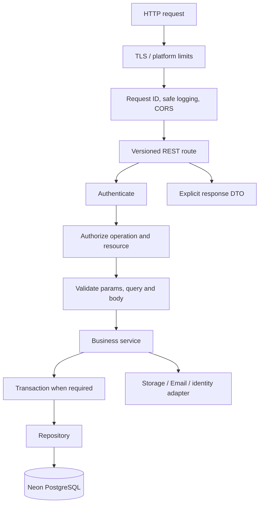

# ASTEC Backend Architecture

**Status:** Proposed implementation design for the Deno API foundation; not
implemented. See [target-architecture.md](./target-architecture.md) for system
decisions and [database-blueprint.md](./database-blueprint.md) for persistence.

## 1. Runtime and responsibilities

Retain Deno as the initial backend candidate. The existing function currently
serves `GET /health`; most infrastructure helpers are tied to Supabase and are
not a completed independent backend. Before feature implementation, replace
those dependencies only under an approved implementation phase and validate
the Neon/Drizzle/identity combination in a disposable environment.

The API owns:

- Authentication verification and authorization.
- Validation of all untrusted input.
- Domain workflows, state transitions and transaction boundaries.
- Repository/database access and response DTOs.
- Storage and email provider adapters.
- Rate limiting, idempotency, logging, errors, audit events and API docs.

It does not own Angular rendering, database schema migration execution during
normal request handling, or binary storage.

## 2. Feature-module organization

```text
apps/api/src/
  main.ts
  core/
    config.ts errors.ts logger.ts request-context.ts
    database.ts transaction.ts
  http/
    router.ts response.ts error-mapper.ts openapi.ts
  middleware/
    authentication.ts authorization.ts csrf.ts cors.ts rate-limit.ts
  modules/
    auth/
    users/
    cms-pages/
    events/
    stories/
    media/
    community/
    contacts/
    newsletter/
    elections/
    settings/
    audit/
  integrations/
    identity/ storage/ email/
  workers/
    outbox-worker.ts
  tests/
```

Within a feature module, keep route/controller mapping, request DTO/schema,
service/business rules, and repository interface/implementation clearly
separated. Avoid a giant global service or cross-feature SQL from controllers.
Shared packages may contain transport types and validation contracts, not
server credentials or database entities imported into browser bundles.

## 3. Request path and API conventions



- Prefix product endpoints `/api/v1`. Keep health/readiness checks outside
  product versioning if deployment tooling requires it.
- Use resource-oriented nouns and HTTP semantics; use explicit action endpoints
  only for domain commands such as `POST /events/{id}/publish`.
- Validate path, query, headers and body at the boundary. Apply limits to
  request size, pagination, sorting and accepted file metadata.
- Return stable JSON error shape such as `{ error: { code, message, requestId,
  details? } }`; never expose stack traces or SQL/provider messages.
- Use `400` for malformed/invalid input, `401` unauthenticated, `403`
  unauthorized, `404` unavailable/unknown resources, `409` state conflicts,
  `429` throttled, and `5xx` unexpected infrastructure failures.
- Use idempotency keys for retryable create operations where clients or
  provider callbacks may retry. Avoid idempotency for arbitrary requests
  without defined retention/uniqueness semantics.
- Publish OpenAPI with request/response schemas and auth requirements; generate
  or test the shared Angular client against the contract.

## 4. Authorization

Resolve the authenticated immutable subject to an active `app_users` record.
Load canonical roles/permissions server-side. Every protected operation checks
the capability and resource-level conditions (owner, state, visibility,
tenant/scope if later required). Use deny-by-default behavior.

Examples of capabilities to define and approve: `cms.pages.read`,
`cms.pages.publish`, `events.manage`, `members.read`, `members.manage`,
`media.upload`, `community.moderate`, `settings.manage`, `elections.manage`.
These are proposals, not established roles or assignments. Do not mirror the
admin UI's mock role names without validating and approving a permission map.

## 5. Database access and transactions

Repositories own parameterized Drizzle queries and return persistence models;
services own business decisions and transaction orchestration. Controllers
must not execute SQL. Use a request-scoped or pooled connection strategy
supported by the chosen Deno/Neon deployment; do not create an unbounded pool
per request or place a connection URL in browser code.

The initial Phase 5 connection module uses Drizzle's Neon HTTP driver for
connectivity checks and independent statements. Neon documents HTTP support
for single queries and multi-statement non-interactive transactions; it does
not provide an interactive session. Before implementing a workflow requiring
read/decide/write semantics, use a driver with verified interactive transaction
support and test it on the selected runtime/host. The migration CLI is a
separate development/release tool and must use a dedicated direct migration
connection, not the API runtime connection.

Transaction candidates:

- Create member identity/profile using provider/API flow with explicit
  compensation semantics if providers cannot share a transaction.
- Publish page and record audit/outbox events atomically.
- Reserve event capacity and create a registration atomically.
- Apply role changes and append audit record atomically.
- Change election state and lock or publish results under privileged controls.

Use reviewed SQL migrations separately under `infrastructure/database/migrations`. A
request handler must not run schema migrations. Prefer explicit transactions
only where invariant boundaries require them; driver support must be validated.

## 6. External service adapters

Define narrow interfaces for identity, object storage, and email. Services
depend on interfaces, not vendor SDK types. Keep retries, timeouts, idempotency,
error mapping and provider observability in adapters. Do not silently convert
provider errors into successful results.

Use a transactional outbox for email and asynchronous side effects. Write the
business row and outbox record in the same DB transaction; a worker claims,
delivers, and records retry state. Delivery remains at-least-once unless the
provider offers a reliable idempotency mechanism. Do not send sensitive
submission contents to email unless required and approved.

## 7. Background work and deployment

Deno Deploy's current documentation lists no queues. Do not build durable
background work around an in-memory timer, a request lifecycle, or local disk.
Use a separately deployed worker and durable outbox, plus an external scheduler
or queue if workload requirements justify one. Initial low-volume retryable
jobs may poll the DB on a scheduled worker; use `FOR UPDATE SKIP LOCKED` only
after confirming support and concurrency semantics of the selected driver.

Keep API and worker deployment independently restartable. Use health and
readiness checks, graceful shutdown, bounded concurrency/timeouts, secret
management, deploy rollback, and tested backup/restore. Do not tie long-running
file processing or email sending to user-facing request latency.

## 8. Errors, logging, and security controls

- Correlation/request ID on every response and structured log entry.
- Safe error codes at boundaries; detailed internal diagnostics with redaction.
- Never log passwords, cookies, bearer tokens, reset links, full PII payloads,
  storage signing secrets, or DB URLs.
- Validate trusted proxy headers; set HTTPS, secure headers, strict CORS and
  origin policy.
- Add rate limits by route and principal/IP as appropriate, public form abuse
  controls, request body limits and upload limits.
- Use least-privilege DB/runtime and migration credentials, rotation and
  environment separation.
- Audit privileged changes, role assignments, content publishing, and
  election actions; make audit rows append-only to application roles.
- Alert on elevated 5xx, auth failures, job backlog, failed deliveries, DB
  connection saturation, and storage verification failures.

## 9. Testing and documentation

Required layers before production:

1. Unit tests for services and authorization policies.
2. Repository/integration tests against disposable PostgreSQL/Neon-compatible
   environment and applied migrations.
3. HTTP contract tests for validation, errors, permissions, pagination, and
   idempotency.
4. Identity, cookie/CSRF, storage and email adapter tests with synthetic data.
5. End-to-end tests across Angular website/admin -> API -> persistence.
6. Failure tests: DB unavailable, storage timeout, duplicate retry, worker
   crash, expired auth and rollback.

Keep OpenAPI and operational runbooks with API code and docs. Do not describe a
form as submitted or a CMS change as published until the API confirms durable
success.
