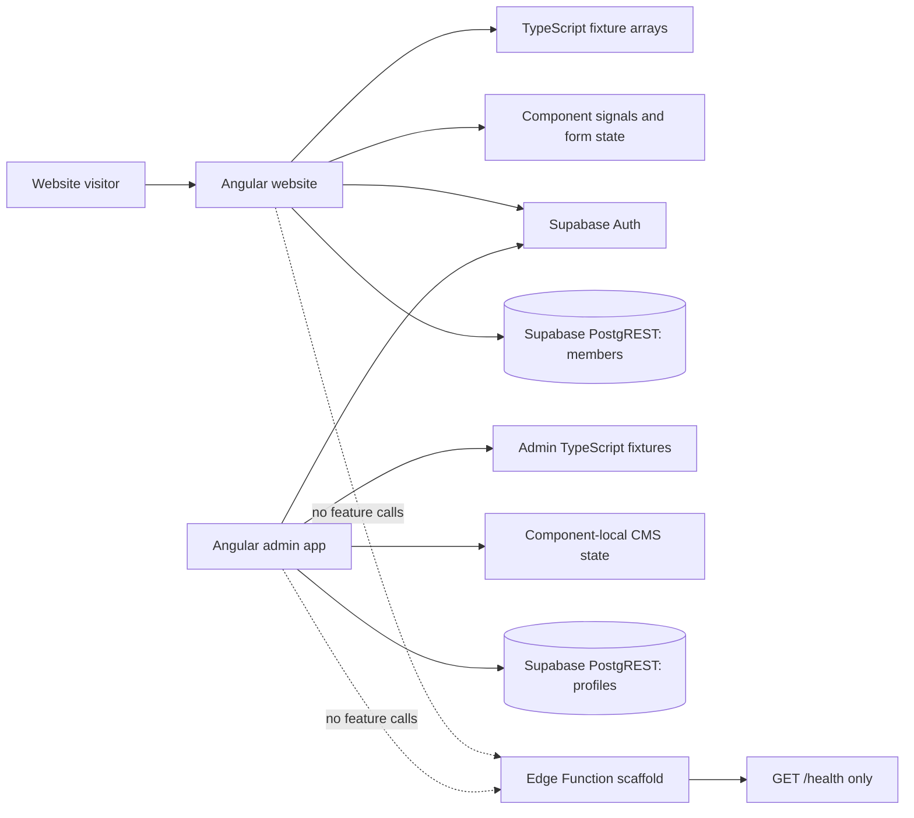
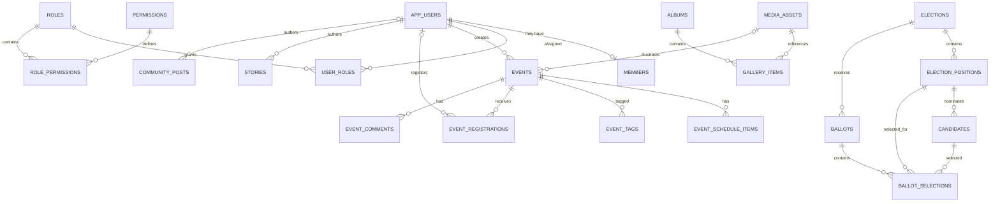

# ASTECAA Data Architecture Audit

**Status:** Historical source-code audit baseline. It predates the Neon event
CMS integration and removal of Supabase browser/Edge Function runtime code. No
database or application data was changed by this audit.
**Scope:** Current `apps/`, `packages/`, and `infrastructure/` implementation,
including the backend foundation added during the architecture separation.
**Evidence boundary:** Repository source and local configuration only. No live
Supabase schema was queried.

## 1. Executive summary

ASTECAA currently has two Angular applications, shared TypeScript packages, and
a newly scaffolded Deno/Supabase Edge Function. The applications do not yet use
a centralized application API for content or CMS workflows:

- The website's events, memories, timeline, community messages, organizers, and
  milestones are TypeScript constants.
- Admin content, people, roles, contacts, announcements, settings, and media
  are constants or component-local state. Most actions only change that state
  until the page reloads.
- Voting is a demo held in in-memory arrays, a `Map`, and a `Set`; OTP
  verification accepts a fixed demo code.
- The only active database-like requests from the applications are Supabase
  Auth operations and direct profile reads/member-profile insertion.
- The API scaffold currently serves a health check. Its auth, profile repository,
  and storage helpers are not wired into feature routes or called by either app.

No database schema, actual migration, seed SQL, RLS policy, trigger, database
function, storage bucket definition, or deployed Edge Function configuration is
present in the repository. The Supabase CLI is not installed in the inspected
environment. Thus the live schema, data, policies, and bucket state remain
**unverified**; table references below are observations from source, not a
verified description of the connected project.

The proposed Neon model later in this report is a design proposal only. It is
not a migration plan execution, and it does not assert that mock content is
production data.

## 2. Evidence and Supabase verification status

| Evidence source | Finding | Confidence |
|---|---|---|
| `apps/website/src/services/member-auth.ts` | Direct Supabase Auth use and direct `members` table read/insert | Verified in source |
| `apps/admin/src/auth.service.ts` | Direct Supabase Auth use and direct `profiles` table read | Verified in source |
| `packages/config/src/index.ts` | Shared browser Supabase client; URL and publishable/anon client key are embedded in source | Verified in source; values intentionally omitted |
| `apps/api/supabase/config.toml` | Local Edge Function config disables gateway JWT verification for this function | Verified in source |
| `apps/api/src/**` | Helpers call Supabase Auth, PostgREST, and Storage REST endpoints if invoked | Verified in source; not wired into app feature flows |
| `infrastructure/database/` | README placeholders only; no SQL schema or policy files | Verified in repository |
| `.env` | Tracked file; only variable names were inspected. No values are reproduced here. Names use the `VITE_SUPABASE_*` convention, while the current client imports hard-coded config instead | Verified in repository metadata |
| Supabase CLI / live project | CLI was not available; no live database query was performed | Not verified |

No claim in this report about live table columns, keys, constraints, indexes,
RLS, row contents, storage buckets, triggers, or deployed functions should be
treated as live-database fact.

## 3. Current data inventory

Types below describe the source-level contract, not necessarily persisted
PostgreSQL columns. `string` date values are not consistently ISO timestamps;
several interface fields are UI display values or derived statistics rather
than appropriate canonical database fields.

### 3.1 Public website data

The public fixtures and interfaces are in
[`apps/website/src/data.ts`](../apps/website/src/data.ts).

| Entity / data set | Source-level fields and types | Origin and present storage | App / access pattern | Classification |
|---|---|---|---|---|
| `EventItem` / `EVENTS` | `id`, `title`, `subtitle`, `description`, `longDescription`, `date`, optional `endDate`, `time`, `venue`, `city`, `category`, `poster`, `banner`, `organizer`, `organizerRole`, `organizerPhoto`: strings; `gallery`, `tags`: string arrays; `schedule`: array of `{time,title,detail}` strings; `capacity`, `registered`: numbers | Hard-coded TypeScript records; image paths refer to `apps/website/public` | Website home/events/details; read-only | Demo/content fixture, not connected to CMS |
| `MemoryItem` / `MEMORIES` | `id`, `title`, `event`, `image`, `caption`, `album`: strings; `year`: number; `format`: `'photo' \| 'video'` | Hard-coded TypeScript; media path references static files | Website home/gallery/about; read-only | Demo fixture |
| `TimelineMilestone` / `TIMELINE` | `id`, `title`, `story`, `image`: strings; `year`: number; optional `quote`, `quoteAuthor`: strings; optional `hasVideo`: boolean | Hard-coded TypeScript | Website timeline/home; read-only | Demo fixture |
| `CommunityMessage` / `MESSAGES` | `id`, `author`, `location`, `avatar`, `message`, `date`: strings; `likes`: number; optional `liked`, `pinned`: booleans; optional `replies`: recursive `CommunityMessage[]` | Seed-like hard-coded TypeScript; a submitted message is prepended to component signal state only | Website community and event details; fixture read and ephemeral create/like | Fixture plus browser-memory interactions; no persistence |
| `Organizer` / `ORGANIZERS` | `id`, `name`, `role`, `photo`, `years`, `bio`: strings | Hard-coded TypeScript | Website About/home; read-only | Fixture; not linked to account/admin identities |
| `Milestone` / `ABOUT_MILESTONES` | `year`, `title`, `text`: strings | Hard-coded TypeScript | Website About; read-only | Fixture; overlaps conceptually with `TimelineMilestone` but has a different shape |
| `NAV_ITEMS` | Navigation label/path and related display metadata (inferred from its literal and use) | Hard-coded TypeScript | Website navbar/footer; read-only | Static application configuration, not CMS data |
| Event comments | Component creates `{id, author, email, location, avatar, message, date, likes}`; most values are strings and likes is a number | Initial values come from `MESSAGES`; added values exist only in `EventDetails.comments` signal | Website event detail; local create/like | Demo/ephemeral; no request is sent |
| Event registration form | `name`, `email`, `phone`, `graduationYear`: strings | Angular component state only | Website event detail; browser validation, then success toast | Not submitted or persisted |
| Contact form submission | `name`, `email`, `subject`, `message`: strings; `captcha`: boolean | Angular component state only | Website contact; validation is client-side, then toast and clear | Not submitted; checkbox is not a verified CAPTCHA service |
| Newsletter form | `email`, `name`: strings | Footer component state only | Website footer; success toast and clear | Not submitted or persisted |
| Community submission payload | `name`, `email`, `phone`, `graduationYear`, `message`: strings; public `CommunityMessage` omits stored email/phone | Browser state; new message appears only in the current component | Website community; local create/like | Not submitted; moderation message is only UX copy |
| Member account/profile | Auth email/password handled by Supabase Auth; app profile `id`, `full_name`, `graduation_set`, `email`: strings; `phone`: nullable string | Auth provider plus direct `members` row access | Website registration/login/member state | Real provider interaction is implemented; actual project schema/rows are unverified |
| Voting inputs | `VoterDetails`: `name`, `email`, `phone`, `graduationYear` strings; position-to-candidate selections are `Record<string,string>` | Component memory; not sent to server | Website voting UI | Demo only |

The static event, gallery, timeline, and community data is not synchronized with
admin content. The UI shows route-specific website content but does not retrieve
it from a backend.

### 3.2 Admin/CMS data

Most shared fixture types and arrays are in
[`apps/admin/src/admin-data.ts`](../apps/admin/src/admin-data.ts). Several other
models are declared only inside their component.

| Entity / data set | Source-level fields and types | Origin and present storage | App / access pattern | Classification |
|---|---|---|---|---|
| Admin UI `Role` | String union: `Super Administrator`, `Content Manager`, `Event Manager`, `Community Moderator`, `Gallery Manager`, `Editor`, `Membership Manager` | TypeScript union and fixtures | Admin user/role screens | Demo UI vocabulary; not the auth role union |
| `AdminUser` / `ADMIN_USERS` | `id`, `name`, `email`, `avatar`, `joined`, `lastActive`: strings; `role`: `Role`; `status`: `'active' \| 'suspended' \| 'pending'`; `events`, `posts`: numbers | Hard-coded fixture; status/role edits update local signal | Admin users/dashboard; local approve, suspend, role edit | Demo/mock; no invites or CSV export are sent/generated |
| `AdminEvent` / `ADMIN_EVENTS` | `id`, `title`, `date`, `venue`, `category`, `poster`: strings; optional `time`, `description`: strings; `status`: published/draft/scheduled/archived; `registered`, `capacity`: numbers; `featured`: boolean | Separate hard-coded event records from public `EventItem` | Admin events/dashboard; local create/edit/publish/delete | Demo/mock, disconnected from public events |
| `AdminGalleryItem` / `ADMIN_GALLERY` | `id`, `title`, `thumb`, `album`, `uploaded`, `size`: strings; `year`: number; `type`: photo/video; `featured`: boolean | Hard-coded fixture | Admin gallery; local select/feature/delete | Demo/mock, not connected to public `MEMORIES` or file storage |
| `MediaItem` | `id`, `name`, `folder`, `url`, `date`, `size`: strings; `type`: image/video; `tags`: string array | Component-local hard-coded fixture | Admin media; local filter/delete; upload only shows a toast | Demo/mock; not stored in a bucket |
| `AdminStory` / `ADMIN_STORIES` | `id`, `title`, `excerpt`, `author`, `authorAvatar`, `category`, `date`, `cover`: strings; status published/draft/archived; `views`, `comments`: numbers | Hard-coded fixture | Admin stories; local editing and publishing | Demo/mock. The editor also uses a `body` value not present in the declared interface |
| `Announcement` | `id`, `title`, `body`, `date`: strings; status published/scheduled/draft; `pinned`: boolean; channel email/push/site | Component-local fixture | Admin announcements; local create/edit/pin/delete | Demo/mock; no email/push/site publishing occurs |
| `AdminComment` / `ADMIN_COMMENTS` | `id`, `author`, `avatar`, `message`, `page`, `date`: strings; status approved/pending/reported/spam; `likes`, `reports`: numbers | Hard-coded fixture | Admin comments; local moderation actions | Demo/mock; no FK from `page` to content |
| `AdminContactMsg` / `ADMIN_CONTACT` | `id`, `name`, `email`, `subject`, `message`, `date`: strings; status new/read/replied/closed | Hard-coded admin inbox examples | Admin contact; local state transitions and “reply” toast | Mock; not populated by the public contact form |
| `RolePermission` / `ADMIN_ROLES` | `role`: `Role`; permission flags `users`, `events`, `gallery`, `stories`, `comments`, `announcements`, `settings`: booleans; `members`: number; `color`: string | Hard-coded fixture; toggles/save are local | Admin roles | Demo/mock; does not authorize requests |
| `AdminNotification` / `ADMIN_NOTIFICATIONS` | `id`, `text`, `time`: strings; `type`: user/event/comment/gallery/system; `unread`: boolean | Hard-coded fixture | Admin layout; read/display state is not persisted | Demo/static |
| `AdminActivity` / `ADMIN_ACTIVITY` | `id`, `user`, `avatar`, `action`, `target`, `time`, `icon`: strings | Hard-coded fixture | Admin dashboard/activity feed | Demo/static; not an audit log |
| `ADMIN_USER` | `name`, `avatar`: strings; `role`: UI `Role` | Hard-coded single admin display identity | Admin layout | Static placeholder; not derived from authenticated profile |
| Homepage editor state | `hero` strings; featured event ID and story-name string list; story-option strings; stats as `{label,value}` strings; sections `{id,name,description,enabled}`; footer strings/social links | Component-local hard-coded object and signal | Admin homepage editor; `saveAll()` only shows toast | Demo/mock; public home does not consume it |
| General/site settings | Site name/tagline/contact values are strings; maintenance/registrations/comments/newsletter flags are booleans | Component-local hard-coded settings | Admin settings; save only shows toast | Demo/mock |
| Branding settings | Array of `{name,value}` string color entries | Component-local constants | Admin settings | Static editor configuration |
| SEO settings | `title`, `description`: strings | Component-local object | Admin settings; save only shows toast | Demo/mock; does not update route metadata |
| Navigation settings | Array of `{label,path}` strings | Component-local object | Admin settings | Demo/mock; disconnected from `NAV_ITEMS` |
| Email template | Template name, subject and body strings | Component-local defaults | Admin settings | Demo/mock; no mail service |
| Analytics/chart points | `ChartPoint` is `{label:string,value:number}`; growth/engagement/traffic arrays | Hard-coded data | Admin dashboard charts | Demo/static; not query results |
| Admin UI state | Theme, collapsed/mobile/notification/search signals are boolean/string UI state | Browser memory | Admin navigation/layout | Ephemeral UI state; not business data |

### 3.3 Voting data

The contracts are in
[`packages/types/src/voting.ts`](../packages/types/src/voting.ts); the current
implementation is
[`packages/api-client/src/voting.service.ts`](../packages/api-client/src/voting.service.ts).

| Entity | Source-level fields and types | Current origin/storage | CRUD/use | Classification |
|---|---|---|---|---|
| `Election` / `MOCK_ELECTIONS` | `id`, `title`, `start_date`, `end_date`, `created_at`: strings; `description`: nullable string; `is_active`, `results_published`: booleans | Hard-coded fixture and service signal | Local create/update/delete/toggle; read by website/admin | Mock; state resets on reload |
| `Position` / `MOCK_POSITIONS` | `id`, `election_id`, `title`: strings; `description`: nullable string; `sort_order`: number | Hard-coded mutable array | Local CRUD | Mock; intended parent relation to election is not a database FK |
| `Candidate` / `MOCK_CANDIDATES` | `id`, `position_id`, `full_name`: strings; optional `graduation_year`: number, `department`: string; `biography`, `manifesto`, `photo_url`: nullable strings; `sort_order`: number | Hard-coded mutable array | Local CRUD | Mock; intended parent relation to position is not persisted |
| Vote count | `CandidateWithVotes.vote_count`, position/election totals: numbers | `Map<candidateId,number>` in service memory | Local increment/count | Mock; no ballot or database record |
| Participation state | `Set<electionId>` | Service memory | `finalizeVote()` marks election as voted | Mock; global per browser service, not per voter; resets on reload |
| OTP state | Voter details above and six-character input | Browser form; fixed code in service | Request/verify methods | Mock; no OTP delivery, identity proof, eligibility check, or secret |
| Election results | `results_published`: boolean and derived counts | Local mutable fixture state | Admin toggles locally; public results UI reads service | Mock |

An application-only service named `VotingService` is exposed from the package
named `api-client`, but it does not make HTTP requests. It is not a backend API
client today.

### 3.4 Data types that are absent

No typed entity, data collection, route-backed CRUD, or persisted schema was
found for standalone **projects**, **services**, or **publications**. Some static
copy mentions association/school projects, fundraising, mentorship, and news;
that text is not evidence of project or publication records. `AdminStory` and
`Announcement` are the implemented editorial concepts. Do not create rows for
the absent concepts without confirming product requirements and source data.

## 4. Supabase dependency inventory

### 4.1 Browser applications

1. [`packages/config/src/index.ts`](../packages/config/src/index.ts) constructs
   one Supabase JS client with persisted sessions, token refresh, and URL-session
   detection. It currently embeds the public URL and publishable/anon client key.
   The key is omitted from this report. The repository `.env` is not read by
   this client.
2. Website [`member-auth.ts`](../apps/website/src/services/member-auth.ts):
   - Auth: `getSession`, `onAuthStateChange`, `getUser`, `signUp`,
     `signInWithPassword`, `signOut`.
   - Database/PostgREST: `members` select of `id, full_name, graduation_set,
     email, phone`; `members` insert with those profile fields and Auth user ID.
     The client sets `members.id` to the Supabase Auth user ID and reads by that
     value, implying an intended identity relationship; no FK definition is
     present to verify it.
3. Admin [`auth.service.ts`](../apps/admin/src/auth.service.ts):
   - Auth: `getSession`, `onAuthStateChange`, `signInWithPassword`, `signOut`,
     `resetPasswordForEmail`.
   - Database/PostgREST: `profiles` select of `id, full_name, role, is_active,
     email, phone, avatar_url, created_at, updated_at`.
     Profile lookup filters `profiles.id` by the Auth user ID, implying an
     intended identity relationship; no FK definition is present to verify it.
   - The returned role/active flag is checked in client code. `admin.guard.ts`
     uses that client state for route navigation; that is not server-side or
     database authorization evidence.
4. No application source uses Supabase SQL RPC, database triggers, Database
   Realtime subscriptions, Supabase Storage SDK, or Supabase Functions SDK.
   `onAuthStateChange` is an Auth SDK event listener, not a database Realtime
   channel.

### 4.2 API scaffold (not yet a live app data path)

The Deno scaffold under [`apps/api/`](../apps/api/README.md) contains:

- `GET /health` and `OPTIONS` handling in `src/http/handler.ts`; all other
  requests receive 404.
- `requireUser()` verifies a bearer token by calling Supabase Auth's user
  endpoint using the anon key. `requireAdmin()` reads `profiles` through
  PostgREST and checks `role` and `is_active`.
- `ProfilesRepository` reads `profiles` with the request access token.
- `MediaStorageService` posts to the Supabase Storage REST API, but no feature
  route invokes it and no bucket/policy is defined in this repository.
- `AuthService` wraps auth helpers but is not called by the health handler.
- `parseJson()` and shared validation primitives exist but no feature endpoint
  uses them.
- `apps/api/supabase/config.toml` sets `verify_jwt = false`. This is currently
  compatible with a public health endpoint, but any future protected endpoint
  must call its authentication/authorization middleware itself. The gateway
  setting must be consciously revisited before production.

There is no Supabase `db` configuration, schema dump, migration, seed file,
storage bucket definition, trigger/function SQL, or live function deployment
evidence. The single migration directory file is a README placeholder, not a
migration.

### 4.3 What cannot be verified live

The repository's two inferred table names (`members`, `profiles`) and selected
fields do not establish live schema. Their keys, foreign keys, constraints,
indexes, RLS policies, triggers, generated columns, and row contents are
unknown. Auth's internal `auth.users` schema is provider-managed and is not
described here. Source code implies that `members.id` and `profiles.id` are
intended to match the Auth user ID, but neither a foreign key nor one-to-one
constraint has been verified. Storage bucket presence and policies, Auth provider settings,
email/SMS configuration, deployed functions, and project Realtime settings are
also unknown. The report does not expose `.env` contents or any key values.

## 5. Data-flow analysis

### 5.1 Current flows



### 5.2 Flow-by-flow findings

| Flow | Current movement | Persistence/integration status |
|---|---|---|
| Public content | `data.ts` constants -> website components | No backend read; hard-coded |
| Admin content editing | `admin-data.ts` or component local arrays -> Angular signals -> toast | No backend write; resets on reload; does not publish to website |
| Contact form | Browser fields -> client validation -> toast/reset | No HTTP request and no inbox persistence |
| Community post/comment | Browser fields -> component signal update -> toast | No HTTP request; data is lost on reload; no actual moderation queue |
| Event registration | Browser form -> validation -> success toast | No registration row, API request, payment, or email |
| Newsletter | Browser email/name -> toast/reset | No subscription endpoint or mailing-list provider |
| Member account | Browser -> Supabase Auth; then direct `members` read/insert | Real Auth service integration; profile schema/RLS unverified |
| Admin account | Browser -> Supabase Auth; then direct `profiles` read | Real Auth integration; role gating is client-side for UI; server/data policies unverified |
| Voting | Browser -> in-process mock `VotingService` | Fixed OTP demo, local counts, no external call or persisted ballot |
| Media | Admin page -> local list; API helper exists but is unused | No working upload/delete or verified storage bucket |
| API | Function entry -> HTTP handler | Health only; no CMS, membership, contact, or voting endpoint |

### 5.3 Duplicated and disconnected data

- Website `EventItem` and admin `AdminEvent` represent overlapping concepts with
  different fields and independent IDs/fixtures. Admin edits cannot affect
  public events.
- Website `MemoryItem` and admin `AdminGalleryItem`/`MediaItem` overlap but have
  different shapes and no media identity relationship.
- `CommunityMessage`, event comments, and `AdminComment` overlap conceptually,
  but the admin examples are not sourced from either public form.
- `ADMIN_CONTACT` does not receive messages from the public contact form.
- Homepage/editor settings, admin nav, public `NAV_ITEMS`, public SEO metadata,
  and public page copy are independent.
- Admin UI role names and permission flags differ from auth's role union
  (`alumni`, `admin`, `super_admin`). No verified role-to-permission mapping or
  backend enforcement exists.
- Voting election/position/candidate relationships are represented only by
  fixture IDs. `castVote()` increments counts before `finalizeVote()` marks
  participation; neither operation is transactional or durable.
- Analytics counters (`views`, comments, registrations, chart values) are
  fixture data or UI fields, not demonstrated metrics.

## 6. Identified data architecture problems

| Priority | Finding | Impact / recommendation |
|---|---|---|
| Critical for live elections | Voting OTP is fixed in client code; votes and participation are browser-memory state | Not secure or auditable. Do not use for an election. Design server-side eligibility, ballot privacy, replay prevention, atomic submission, and auditability before schema implementation. |
| High | No verified schema/policy source or migration history | Cannot reproduce or safely migrate the database. Obtain authorized live schema/policy exports and establish migration ownership before Neon design approval. |
| High | Browser writes directly to `members`; browser reads `profiles` | Application authorization depends on deployed RLS that is not available for review. Review policies and test access with least-privilege accounts. |
| High | CMS is disconnected from public content and backend | Admin “save/publish” actions are misleading from a data standpoint. Introduce persistent repositories/API contracts, then connect both apps to the same records. |
| High | Form success can be mistaken for actual submission | Contact, comments, registration, and newsletter data are not transmitted. Add real API integrations and meaningful failure states only after the backend and retention requirements are approved. |
| High | User/role concepts conflict | The admin UI's seven roles and permission matrix do not match the two admin authorization roles or member role. Define canonical roles, capabilities, and migration mapping before exposing role editing. |
| High | Moving only Postgres would not replace Supabase Auth, Storage, or Edge Functions | Choose independent providers or retain those services deliberately. Inventory identities, files, policies, and function behavior separately. |
| Medium | `members` and `profiles` carry overlapping contact fields; profile models do not prove a shared identity model | Confirm whether identities overlap and deduplicate only with verified identifiers. Choose one canonical email/phone source and preserve provider-subject mapping. |
| Medium | Event, memory/gallery, message/comment, settings and nav representations duplicate concepts | Define canonical domain models and an explicit conversion/migration map; do not bulk-import presentation fixtures as production records. |
| Medium | Display/derived fields are mixed into content DTOs (`registered`, `views`, `comments`, `size`, relative `lastActive`) | Persist source facts and derive counts/relative labels. Do not treat demo counters as actual registrations, views, or storage usage. |
| Medium | No declared transaction or integrity semantics for multi-position voting and sign-up/profile creation | Define atomic service operations, uniqueness rules, retry handling, and cleanup/compensation behavior. |
| Medium | Config sources are inconsistent | The tracked `.env` names are not consumed by the client; the shared client embeds its public configuration. Standardize public configuration and secret handling without ever bundling privileged credentials. |
| Low | Static navigation, labels, public copy, and operational settings have no ownership/audit metadata | Decide which values are truly content and which are deployment config before making them editable CMS records. |

## 7. Proposed Neon PostgreSQL architecture

This is a candidate normalized domain model based on observed product concepts.
It is **not** a claim about the existing Supabase schema or a final migration
specification. Confirm requirements, legal retention, identity overlap, content
ownership, and voting privacy before writing DDL. Keep Auth-provider identifiers
separate from app-generated primary keys.

### 7.1 Candidate entities and columns

Use PostgreSQL `uuid` primary keys generated server-side, `timestamptz` for
instants, `date` only for date-only concepts, `text` for human content, explicit
`boolean` flags, checked status values or reference tables, and `jsonb` only for
versioned flexible settings/payloads. A migration must not promote mock values
to production truth.

| Table | Candidate columns and relationships |
|---|---|
| `app_users` | `id uuid PK`; `auth_subject text UNIQUE NOT NULL` (opaque ID from chosen identity provider); `email text NOT NULL`; `full_name text`; `phone text`; `status text NOT NULL`; `created_at`, `updated_at timestamptz`. Decide email normalization/case handling and uniqueness policy before constraint. |
| `members` | `user_id uuid PK/FK -> app_users.id`; `graduation_set text`; optional verified alumni attributes only after domain confirmation. Avoid duplicating name/email/phone without a specific history requirement. |
| `roles`, `permissions` | Stable `code text UNIQUE`, display name/description; permissions similarly use stable code. |
| `user_roles`, `role_permissions` | Join tables with FKs and composite unique/primary keys. Scope assignments (global vs association/tenant) only if required. Map current UI labels separately; they are not established canonical roles. |
| `events` | `id uuid PK`; `slug text UNIQUE`; `title`, `subtitle`, `description`, `long_description text`; `starts_at`, nullable `ends_at timestamptz`; `venue`, `city`, `category text`; `capacity integer CHECK (capacity > 0)` nullable if unlimited; `status`; `featured boolean`; `poster_media_id`, `banner_media_id` nullable FKs to media; `created_by`, `updated_by` FKs; timestamps. Store confirmed registration totals as derived values, not mutable mock counts. |
| `event_schedule_items` | `id uuid PK`; `event_id uuid FK ON DELETE CASCADE`; `starts_at timestamptz` or an explicit display-time string if timezone/precision requirements demand it; `title`, `detail text`; `sort_order integer`. Clarify whether schedule items can span days. |
| `event_tags` | `event_id uuid FK`; `tag text`; composite PK/unique `(event_id, tag)` if tags need filtering/search. |
| `event_registrations` | `id uuid PK`; `event_id uuid FK`; nullable `user_id uuid FK`; registrant name/email/phone snapshot fields for guest registration; `graduation_year` only if product retains that field; status; timestamps. Define duplicate-registration, cancellation, capacity reservation, and PII retention rules before unique constraints. |
| `stories` | `id uuid PK`; `slug text UNIQUE`; `title`, `excerpt`, `body text`; author user FK or explicit attribution snapshot; category; cover media FK; status; `published_at`; timestamps. Keep `views`/comment counts derived or evented, not imported from demo numbers. |
| `announcements` | `id uuid PK`; `title`, `body text`; `channel` enum/check (`site`, `email`, `push`); status; `pinned boolean`; optional `publish_at`; creator/updater FKs and timestamps. Delivery records/outbox should be separate if email/push delivery is implemented. |
| `media_assets` | `id uuid PK`; storage provider, bucket/container, object key, original filename, MIME type, byte size, checksum, alt text/caption, uploader FK, visibility/status and timestamps. Unique object locator; actual bytes stay in object storage, not Neon. |
| `albums`, `gallery_items` | `albums`: id, slug, title, description, year/date, status. `gallery_items`: id, album FK, media FK, caption, year if independently meaningful, featured, sort order, status, timestamps. Decide whether one asset can appear in many albums before modeling junctions. |
| `timeline_entries` | `id uuid PK`; year/date, title, story, media FK, optional quote/attribution, video/media reference, sort order, publish status. The About-page `Milestone` shape should be reconciled with the fuller timeline before consolidation. |
| `community_posts` | `id uuid PK`; nullable user FK or separately confirmed guest-attribution fields; message text; location only if collection/retention is approved; moderation status; pinned flag; created/updated/published timestamps. |
| `event_comments` | `id uuid PK`; `event_id uuid FK`; nullable author user FK plus moderation-safe attribution fields; message; status; timestamps. Do not retain email redundantly unless operationally required. |
| `post_likes`, `comment_reports` | Join/event tables with FKs and uniqueness constraints per actor/target where authenticated interaction is required; report reason/status and timestamps for moderation. |
| `contact_submissions` | `id uuid PK`; `name`, `email`, `subject`, `message text`; status; received/updated timestamps; optional assigned admin FK; reply metadata/outbox relationship only after a real mail workflow is chosen. Do not store CAPTCHA response tokens long term. |
| `newsletter_subscriptions` | `id uuid PK`; email; optional name; status/consent source and timestamps; confirmation/unsubscribe tokens stored securely if required. Define consent evidence, uniqueness, unsubscribe, and retention. |
| `site_settings` | Stable `key text PK`; schema/versioned `value jsonb`; updater FK; updated timestamp. Separate operational secrets from this table; do not store secrets as CMS settings. Version/validate homepage, SEO, navigation, branding and email-template values before using JSONB. |
| `elections` | `id uuid PK`; title/description; `starts_at`, `ends_at timestamptz`; status; `results_published boolean`; creator/updater FKs; timestamps; check `ends_at > starts_at`. |
| `election_positions` | `id uuid PK`; `election_id uuid FK ON DELETE CASCADE`; title/description; `sort_order integer`; unique ordering only if product requires it. |
| `candidates` | `id uuid PK`; `position_id uuid FK`; name, graduation year, department, biography, manifesto; photo media FK; sort order; status. Add composite unique `(id, position_id)` if needed for a composite vote FK. |
| `election_participation` and anonymous ballots | Store eligibility/participation separately from ballot selections. A keyed, non-reversible voter token may enforce one submission, but key custody, eligibility, concurrency, audit, re-vote and legal requirements need specialist design. Avoid a direct member FK on vote rows if anonymity is required. |
| `ballots`, `ballot_selections` | Candidate proposal: ballot `(id,election_id,cast_at)`; selection `(ballot_id,position_id,candidate_id)` with unique `(ballot_id,position_id)` and a composite FK ensuring the candidate belongs to that position. Use a single transaction/service operation for eligibility consumption and all selections. Review whether timing/metadata could deanonymize voters. |
| `audit_events` | `id uuid PK`; actor FK or service identity; action/resource identifiers; redacted structured metadata; timestamp and request ID. Append-only policy and retention/access controls; never log passwords, tokens, ballot selections linked to voters, or raw PII unnecessarily. |

### 7.2 Relationship sketch



`APP_USERS` and all tables in this diagram are proposed names. The optional
membership relationship and all multiplicities must be confirmed against real
identity records. Anonymous participation intentionally is not drawn as a
direct relationship to a ballot.

### 7.3 Indexes and integrity rules to evaluate

- Unique normalized email only if current/target account rules allow one account
  per address; also unique `auth_subject`.
- Index foreign-key columns used for joins and deletes (PostgreSQL does not
  automatically index the referencing side of every FK).
- Events: `(status, starts_at)` for public upcoming events; unique `slug`.
- Stories/announcements: `(status, published_at DESC)` and relevant category
  filters; do not index every text field without query evidence.
- Registrations: `(event_id, status)`; define duplicate and capacity semantics
  before a unique constraint.
- Moderation queues: `(status, created_at DESC)` for posts, comments, and contact
  submissions.
- Media: unique `(provider,bucket,object_key)` plus folder/album foreign-key
  indexes; check MIME/size constraints server-side as well as in storage.
- Votes: unique `(ballot_id,position_id)`; composite candidate/position
  referential integrity; prevent writes outside an open election in trusted
  transactional logic (time-based checks alone are not a simple static CHECK).
- Add check constraints for valid date order, nonnegative sizes/counts, status
  domains, and required fields. Use transactions for multi-row publishing,
  registration capacity, and ballot operations.

These are candidates to validate with query plans and business requirements,
not immediate DDL.

## 8. Backend data-access architecture

Keep application business rules out of controllers, UI components, and SQL
repositories:

```text
apps/api/src/
  http/                 routing, request/response mapping
  middleware/           identity, authorization, security, request IDs
  modules/<feature>/    feature routes and DTOs
  validation/           boundary schemas
  services/             business transactions and workflows
  repositories/         parameterized Neon/Postgres queries
  storage/              object-storage adapter
  core/                 config, errors, logging, transaction helpers
```

Expected call path: HTTP route -> authenticate/authorize -> validate DTO ->
service -> repository/transaction -> Neon; media workflows use a storage
adapter, and external mail/push calls use adapters/outbox processing. Return
explicit API DTOs rather than database records. Keep SQL migrations separate
from runtime repositories. Use a pooled server-side Neon connection strategy
(including the provider's recommended pooler/driver settings for the selected
runtime); never ship database credentials or a direct Neon connection string to
either Angular app. The apps call the API client, not SQL or privileged
credentials.

Start with versioned SQL migrations and an explicit migration runner/review
process. Seed only deterministic lookup/reference rows and clearly labelled
development fixtures. Do not seed sample members, admins, events, voters, or
content into production without verified authority and source provenance.

## 9. Supabase services and independent replacement decisions

Neon supplies PostgreSQL hosting, not the following Supabase services:

| Current/possible service | Current evidence | If PostgreSQL moves to Neon |
|---|---|---|
| Authentication | Actively used through Supabase Auth for member/admin login, registration, sessions and reset | Choose and operate a separate IdP/auth service, or deliberately retain Supabase Auth and integrate its verified identity subject with Neon. Define JWT issuer/audience validation and account mapping. Do not migrate password hashes or assume compatibility until verified. |
| Database access / PostgREST | Active direct reads/inserts for `members` and `profiles` | Replace direct table access with the backend API or an explicitly designed safe data API. Migrate RLS intent into server authorization and database grants/constraints. If retaining Supabase Auth, PostgREST remains a separate service only if intentionally retained. |
| File storage | Static local images are active; API helper references Supabase Storage but no UI route calls it | Keep Supabase Storage deliberately or select S3-compatible storage (for example S3/R2). Migrate objects, metadata, access controls, public URLs, and CDN behavior separately. Neon does not store/serve the media objects. |
| Edge Functions | A local Deno/Supabase Edge Function scaffold exists; only health route wired | Deploy it as a Supabase Edge Function deliberately, or move to another serverless/container runtime. Update secrets, auth verification, observability, networking and database pooling for Neon. Neon is not an API/compute replacement. |
| Realtime | No database Realtime usage found | No replacement currently needed. If later required, select a WebSocket/pub-sub service and define consistency/replay semantics. Auth change notifications are not database Realtime. |
| Email/SMS | Auth provider may deliver configured emails; public forms/announcements do not integrate a mail provider | Inventory Auth email/reset/confirmation behavior; choose a transactional mail/SMS provider for application notices and OTP. Do not treat frontend toast messages as delivery. |

## 10. Controlled migration roadmap (not executed)

1. **Discover and snapshot current Supabase state.** With authorized project
   access, export table definitions, indexes, constraints, triggers/functions,
   RLS policies/grants, Auth configuration/provider behavior, storage buckets
   and policies, Edge Function deployments/secrets metadata, extensions, and
   approximate row counts. Record timestamp/project identity without recording
   secrets. No Supabase CLI or live access was available during this audit.
2. **Inventory authoritative data and dependencies.** With data owners, label
   each live dataset and object as authoritative, test, stale, or fixture.
   Reconcile `members` vs `profiles`, map IDs and foreign-key dependencies,
   identify retention/consent requirements, and explicitly exclude fixture
   arrays and component-local state from production imports unless owners
   approve a curated content seed.
3. **Approve target schema and ownership.** Decide canonical account model,
   role mapping, CMS workflow, content statuses, media ownership, form retention,
   registration semantics, and election privacy/eligibility. Review the Neon
   design above with the data owner and security/privacy reviewer.
4. **Create migration scripts in reviewable increments.** Establish baseline
   DDL, reference rows, constraints/indexes, rollback/forward-fix practices and
   schema version tracking. Test migrations against a disposable Neon database;
   never run them against production as part of this audit.
5. **Export/import data safely.** Take a consistent source snapshot; map source
   IDs to stable target IDs; transform enums, dates/timezones, JSON and identity
   references explicitly; preserve source IDs where safe or keep a mapping
   table. Validate counts, nulls, duplicate identities, FK orphans, checksums,
   and representative records. Do not import demo fixture values as real rows.
6. **Plan authentication transition independently.** Decide whether to retain
   Supabase Auth or adopt a separate IdP. Test account linking, email
   confirmation, reset flows, session/JWT validation, MFA if required, inactive
   admins, and role migration. Password-hash portability is unverified; if it is
   not safe/supported, use staged password resets or verified account linking.
   Keep a rollback-compatible identity mapping and support window.
7. **Plan file transition independently.** Inventory actual referenced objects,
   distinguish static `public/` assets from any live bucket contents, copy
   objects with checksums and metadata, validate transformed URLs/access
   controls, and keep source objects intact until rollback window expires.
8. **Implement and test backend integration.** Add Neon driver/pool management,
   repositories, services, validation, authorization, transactions and API
   routes. Replace active direct table reads/inserts only after APIs and policies
   are tested. Add object storage and mail adapters separately. Do not expose a
   Neon connection string to the browser.
9. **Update application clients incrementally.** Replace one feature/data path
   at a time (identity/profile, public content, admin CMS, submissions, media,
   then voting). Preserve feature behavior; display meaningful API errors;
   remove demo mode only when equivalent reviewed functionality is live.
10. **Data integrity and regression verification.** Compare row counts,
    checksums and mapped relations; run auth/RBAC/RLS/API contract tests,
    content CRUD and publication tests, upload/download tests, form delivery
    tests, timezone/capacity tests, concurrency tests, and voting security
    reviews. Test backups and restore recovery, not only happy-path migration.
11. **Production cutover and rollback.** Use a rehearsed maintenance/read-only
    window or dual-write/catch-up plan with explicit single-writer rules. Record
    a final source watermark, import delta, verify acceptance thresholds, switch
    traffic/configuration, monitor errors/latency/data parity, and retain source
    Supabase data read-only until owner sign-off. Roll back by routing traffic
    to the old path only while write divergence can be reconciled; define
    decision owner, trigger thresholds, and data reconciliation before cutover.

No migration, export, import, provider change, credential change, or production
cutover was performed.

## 11. Recommended next approvals

Before creating DDL or implementing the backend, approve:

1. Authorized live Supabase schema/policy/storage/Auth discovery and a
   non-secret evidence snapshot.
2. Which current records are authoritative versus demo; specifically whether
   any static content should become production seed data.
3. Canonical member/admin identity and role model.
4. Neon-only database versus retaining Supabase Auth/Storage/Edge Functions.
5. Content, registration, contact, newsletter, and media retention rules.
6. Election eligibility, anonymity, auditing, and one-vote requirements.
7. Migration validation thresholds, downtime tolerance, rollback owner, and
   production cutover window.
