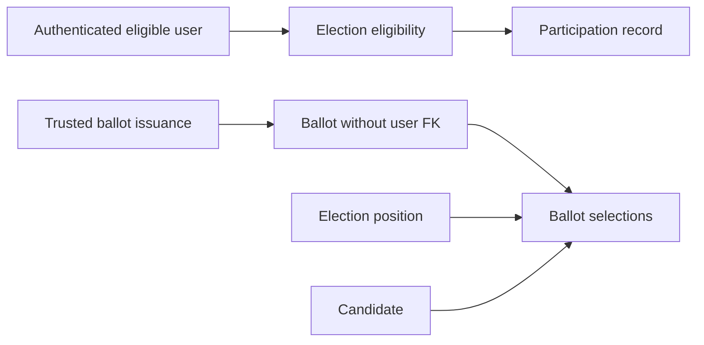

# ASTEC Database Relationships

**Status:** Logical relationship proposal; cardinalities must be confirmed.
No live schema was inspected or modified. See
[database-blueprint.md](./database-blueprint.md) for field definitions and
constraints.

## 1. Core entity relationship diagram

```mermaid
erDiagram
  APP_USERS ||--o| MEMBER_PROFILES : has
  APP_USERS ||--o{ AUTH_IDENTITIES : maps
  APP_USERS ||--o{ USER_ROLES : assigned
  ROLES ||--o{ USER_ROLES : grants
  ROLES ||--o{ ROLE_PERMISSIONS : contains
  PERMISSIONS ||--o{ ROLE_PERMISSIONS : included
  APP_USERS ||--o{ CMS_PAGES : authors
  CMS_PAGES ||--o{ PAGE_SECTIONS : contains
  APP_USERS ||--o{ EVENTS : manages
  EVENTS ||--o{ EVENT_SCHEDULE_ITEMS : schedules
  EVENTS ||--o{ EVENT_TAGS : tagged
  EVENTS ||--o{ EVENT_REGISTRATIONS : receives
  APP_USERS o|--o{ EVENT_REGISTRATIONS : optionally_registers
  APP_USERS ||--o{ STORIES : authors
  MEDIA_ASSETS o|--o{ STORIES : illustrates
  APP_USERS ||--o{ ANNOUNCEMENTS : authors
  ALBUMS ||--o{ GALLERY_ITEMS : contains
  MEDIA_ASSETS ||--o{ GALLERY_ITEMS : references
  MEDIA_ASSETS o|--o{ EVENTS : event_media
  APP_USERS o|--o{ COMMUNITY_POSTS : authors
  EVENTS ||--o{ EVENT_COMMENTS : has
  APP_USERS o|--o{ EVENT_COMMENTS : authors
  EVENT_COMMENTS ||--o{ COMMENT_REPORTS : receives
  APP_USERS o|--o{ CONTACT_SUBMISSIONS : assigns
  APP_USERS ||--o{ AUDIT_LOGS : acts
  APP_USERS ||--o{ SITE_SETTINGS : updates
  ELECTIONS ||--o{ ELECTION_POSITIONS : contains
  ELECTION_POSITIONS ||--o{ CANDIDATES : nominates
  ELECTIONS ||--o{ ELECTION_ELIGIBILITY : defines
  APP_USERS ||--o{ ELECTION_ELIGIBILITY : may_be_eligible
  ELECTIONS ||--o{ ELECTION_BALLOTS : receives
  ELECTION_BALLOTS ||--o{ BALLOT_SELECTIONS : contains
  ELECTION_POSITIONS ||--o{ BALLOT_SELECTIONS : selected_for
  CANDIDATES ||--o{ BALLOT_SELECTIONS : selected
  ELECTION_ELIGIBILITY ||--o| ELECTION_PARTICIPATION : records
  ELECTIONS ||--o{ ELECTION_PARTICIPATION : tracks
```

The diagram omits identity-provider internal tables because their schema is
provider-owned and must be generated from the approved version. `AUTH_IDENTITIES`
maps an `(issuer, subject)` pair to an application principal; it is not a claim
that the current Supabase IDs or profiles already have this shape.

## 2. Relationship cardinalities and ownership

| Parent -> child | Cardinality | Ownership / deletion proposal |
|---|---|---|
| `app_users -> member_profiles` | 1:0..1 | Profile is dependent on application identity; deletion/erasure policy to be approved. |
| `app_users -> auth_identities` | 1:1..many | Each issuer/subject pair maps to one principal; verified linking is required before multiple identities share a principal. |
| `app_users <-> roles` | many-to-many through `user_roles` | Assignment needs server-side authorization; record assigner and time. |
| `roles <-> permissions` | many-to-many through `role_permissions` | Permissions use stable codes; no client-supplied grants. |
| `cms_pages -> page_sections` | 1:many | Sections are page-owned; cascade only after approved page deletion behavior. |
| `events -> event_schedule_items/event_tags` | 1:many | Child schedule/tag rows follow event ownership. |
| `events -> event_registrations` | 1:many | Registrations have independent retention and cancellation history; do not hard-delete casually. |
| `stories -> media_assets` | many:0..1 cover asset | Asset lifecycle is independent; delete/replacement must not orphan content. |
| `albums -> gallery_items` | 1:many | Gallery item belongs to album; media may be referenced independently. |
| `events -> event_comments` | 1:many | Comment moderation lifecycle is independent; enforce ownership/access in API. |
| `community_posts -> app_users` | many:optional author | Guest submissions are possible only if product rules approve them; display identity is not authentication. |
| `contact_submissions -> app_users` | many:optional assignee | Assignment FK is separate from submitter identity. |
| `elections -> positions -> candidates` | 1:many:many | Cascade candidate/position only in draft per election lifecycle; preserve published results and audit history. |
| `elections -> eligibility/users` | many-to-many through eligibility | Eligibility is identity-linked private data. Restrict access. |
| `election_ballots -> ballot_selections` | 1:many | Ballot content must not contain identity references if secrecy is a requirement. |
| `election_participation -> eligibility` | 1:1 per election | Participation tracking is identity-linked; isolate from ballots operationally. |
| `app_users -> audit_logs` | 1:many, actor nullable | Preserve records when a user is erased; remove or pseudonymize actor link by policy. |
| `outbox_messages` | no required direct FK | Durable asynchronous side effect record; payload references should be identifiers, not copied PII where avoidable. |

Optionality of guest access, member registration, media reuse, and authorship
must be approved before DDL. Where a user can own multiple files/albums or
where one asset is reused across many content types, use explicit join tables
instead of overloading a single nullable media FK.

## 3. Voting separation and limits

This depicts a desired separation, not a proven anonymity protocol. If
eligibility and participation are stored alongside timestamped ballots in the
same system, administrators, backups, logs, or timing metadata may still enable
linkage. The data model does not itself prevent correlation, coercion, duplicate
voting, or tampering. Current ASTEC voting is a demo and must not be treated as
an election source of truth.

## 4. Integrity rules

1. Enforce `UNIQUE(issuer, subject)` for identity mappings and validate
   identity-provider issuer/audience outside PostgreSQL.
2. Use foreign keys for all confirmed relationships; index frequently used
   referencing columns.
3. For elections, enforce candidate/position consistency with composite keys,
   not only client checks.
4. For capacity-limited registrations, serialize capacity reservation or use a
   safe atomic update/transaction; do not trust a stale UI count.
5. Use status transitions in trusted service code and append audit events for
   privileged changes.
6. Avoid soft-deletion flags without defining which APIs, indexes, retention
   jobs, and uniqueness rules honor them.
7. Do not use database FKs to imply a verified relationship in the existing
   Supabase deployment; first inspect the real schema and source records.
