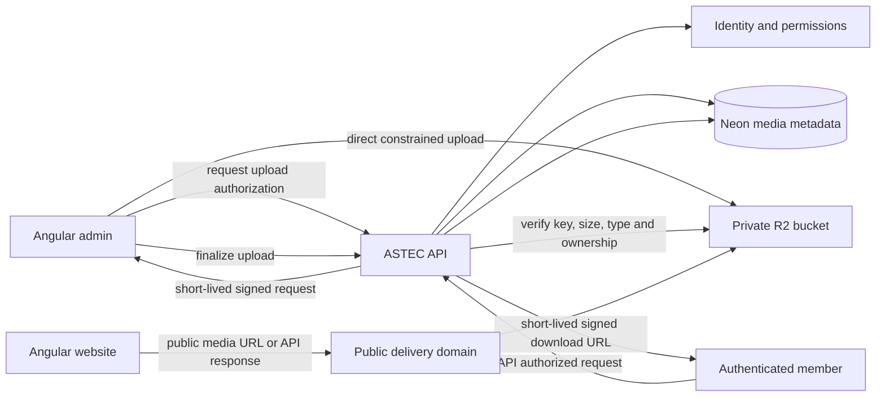

# ASTEC Storage Architecture

**Status:** Proposed independent media design; not implemented.

## 1. Decision

Use a provider-neutral `MediaStorage` interface and keep binary data outside
Neon. Cloudflare R2 is the initial S3-compatible candidate. Final selection
depends on region/data-residency needs, public delivery/CDN, cost, lifecycle,
logging, backup/export, and operational ownership. Neon stores media metadata,
not the file bytes.

Existing content images are static website assets and the admin upload UI is
fixture-backed. The API scaffold contains a Supabase Storage helper, but no
working upload route or bucket configuration was found. This proposal does not
claim there are production Supabase objects to migrate; inventory them with
authorized access before planning any object copy.

## 2. Components and ownership



Only the API holds the R2 account credentials/signing key. The browser receives
a narrowly scoped, short-lived presigned URL only after authentication and
authorization. A direct upload to a private bucket is the preferred path for
large files; the browser must not receive general bucket credentials.

## 3. Storage port

Define an application-facing interface independent of S3 naming:

```text
MediaStorage
  createUploadGrant(objectKey, contentType, maxBytes, expiresAt)
  headObject(objectKey)
  openPublicUrl(objectKey) or buildPublicUrl(objectKey)
  createDownloadGrant(objectKey, expiresAt)
  deleteObject(objectKey)
```

Keep provider setup, signing, endpoint, bucket, and object-key logic inside the
adapter. `MediaService` owns business policy and metadata; routes only handle
HTTP mapping. Provider errors map to safe API errors while retaining a
correlation ID for internal logs.

## 4. Upload workflow and validation

1. Admin requests upload authorization with proposed filename, MIME type,
   byte size, and intended use.
2. API authenticates the user, checks the `media.upload` capability, validates
   allowed type/size, generates an opaque server-side object key, and creates a
   `pending` `media_assets` record.
3. API returns a short-lived upload grant constrained to that key and expected
   content type/length where supported by the provider.
4. Browser uploads directly to private staging/object storage using HTTPS.
5. Browser calls finalize; API performs provider `HEAD` verification of object
   existence, actual size, and content metadata. Do not trust browser claims.
6. Scan/inspect content where the risk model requires it. Transition to
   `available` only after validation; otherwise quarantine/reject and clean up.
7. API returns metadata; public pages use a controlled public delivery URL or
   API-issued short-lived URL for private content.

Validation policy must include allowlisted MIME/extensions, actual file
signature/content inspection where appropriate, size limits, filename
normalization, decompression/image processing risks, malware scanning for
documents, rate limits, and cleanup of abandoned pending uploads. Never use a
user-supplied path as the storage key.

## 5. Public and private access

- **Public assets:** explicitly marked `public` after authorization and
  moderation. Serve through a dedicated public custom domain/CDN. Avoid making
  the entire bucket public by default.
- **Private assets:** keep the bucket private and issue short-lived signed
  downloads only after API checks ownership or capability. Do not persist
  signed URLs in content records.
- **Draft content:** do not expose draft assets through public cache paths.
- **Cache invalidation:** use immutable object keys (new key on replacement),
  controlled cache headers, and metadata references. Avoid overwriting an
  already cached public object when predictable invalidation matters.
- **Deletion:** soft-delete metadata or mark pending removal, then delete
  object asynchronously and retry from an outbox. Define legal retention and
  backups before permanent erase.

## 6. Metadata and object-key rules

Use `media_assets` in [database-blueprint.md](./database-blueprint.md) for
provider, bucket, opaque object key, original filename, MIME type, byte size,
checksum, uploader, visibility, status, caption, and lifecycle timestamps.
Add confirmed media relationships from stories, events, galleries, and
candidates; do not infer them from fixture paths.

Object keys should be generated by the server, unique, non-guessable, and
independent of user-controlled names. Original names are metadata only. Avoid
PII in object keys, logs, and public URLs.

## 7. Provider replacement

To replace R2, implement the same `MediaStorage` contract for the new provider,
copy objects while preserving metadata and checksums, verify object counts and
sample downloads, update routing/configuration, and retain the original bucket
through a rollback window. No Angular app should need provider-specific code.

## 8. Migration and acceptance

1. Discover live Supabase Storage buckets, policies, object owners, sizes,
   public/private behavior, references, and retention through authorized access.
2. Classify each object as verified production, stale, test, or fixture.
3. Map object references to `media_assets`; do not import local fixture paths
   as cloud objects.
4. Copy to a private staging bucket; verify counts, checksums, MIME/size,
   access control, and representative browser delivery.
5. Test upload authorization, tampered metadata, expired links, unauthorized
   downloads, quarantine, deletion retry, and public cache behavior.
6. Switch references only after content acceptance and rollback are ready.
7. Decommission source buckets only after the agreed retention/rollback period.

## 9. Primary reference

- [Cloudflare R2 presigned URLs](https://developers.cloudflare.com/r2/api/s3/presigned-urls/)

