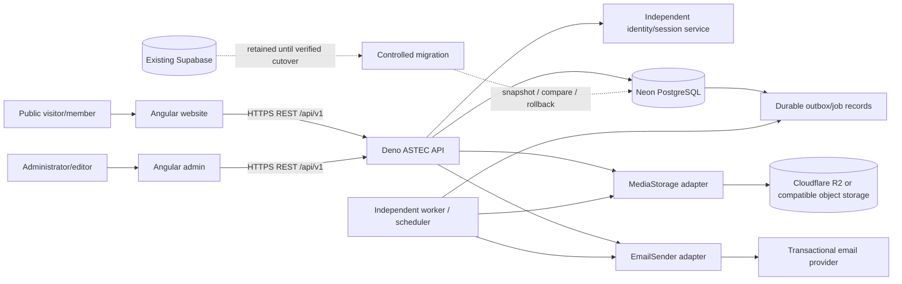

# ASTEC Target Architecture

**Status:** This remains the approved target-architecture proposal. A later
implementation update removed the Supabase SDK and Edge Function scaffold from
the application runtime and connected the event slice and Better Auth session
checks to Neon. No source-project data/accounts or external services have been
migrated, and the platform is not ready for production cutover.

## 1. Executive proposal

Keep the two existing Angular applications and the existing Deno API
foundation. Build the API into the single trusted application boundary for
business operations. Use Neon PostgreSQL for application data and Drizzle as
the proposed typed data-access layer, subject to a Deno 2 proof of compatibility
for the chosen Neon driver, migration tooling, and deployment target. Use an
independent identity service, an S3-compatible object-storage adapter (Cloudflare
R2 is the initial candidate), and a replaceable transactional-email adapter.

The initial authentication candidate is Better Auth because it supports
PostgreSQL and database-backed cookie sessions, matching a first-party API and
Neon deployment. This is conditional: neither an official Angular SDK nor an
official Deno integration was found in the reviewed documentation. Validate
the integration in a disposable proof of concept before approval of Phase 6.
If that gate fails, prefer a standards-based OIDC provider such as Keycloak
rather than writing custom authentication primitives.

Keep the existing Supabase project untouched and available through the
migration and acceptance period. Runtime SDK/scaffold removal is not data
migration or project decommissioning; restore or use a controlled export path
if needed to complete source-data and identity migration.

## 2. Current state and evidence boundary

The source-code audit in [data-architecture-audit.md](./data-architecture-audit.md)
is a historical baseline that found:

- Separate Angular website and admin applications, with shared TypeScript
  packages.
- A Deno/Supabase Edge Function scaffold and direct Supabase browser auth/data
  access. These application runtime paths have since been removed.
- Most content, CMS, contact, newsletter, registration, community, and voting
  data is fixture-backed or held in component memory. Successful UI toasts do
  not establish persistence.
- No checked-in SQL schema or migrations and no live Supabase schema/policy
  inspection. Production data, constraints, storage buckets, deployed functions,
  and authentication settings remain unverified.

The source audit did not verify the live Supabase schema or records. Fixture
values are not production records. Current migration and account status is
tracked in [supabase-removal-roadmap.md](./supabase-removal-roadmap.md).

## 3. Architecture decisions and validation

| Area | Proposal | Rationale and gate |
|---|---|---|
| Web clients | Keep `apps/website` and `apps/admin` as separate Angular applications | Preserves current routing/build boundaries and avoids an unnecessary rewrite. |
| Backend | Continue with `apps/api` on Deno; add feature modules behind a versioned REST API | Deno already has a scaffold and TypeScript support. Do not change runtime absent a demonstrated blocker. |
| Database | Neon PostgreSQL | Explicit platform direction. Neon replaces hosted Postgres only, not auth, storage, jobs, or API compute. |
| ORM | Drizzle ORM | Neon documents Drizzle `neon-http` and `neon-websockets` drivers. Select only after testing the chosen Deno runtime, required transaction semantics, Drizzle Kit/migrations, and pooling behavior together. |
| Authentication | Better Auth, conditional; Keycloak OIDC fallback | Better Auth has PostgreSQL support and cookie sessions, but Angular/Deno interoperability needs a proof of concept. Compare details in [authentication-architecture.md](./authentication-architecture.md). |
| Object storage | `MediaStorage` port with Cloudflare R2 as initial candidate | S3-compatible APIs and presigned URLs allow storage replacement without putting bytes in PostgreSQL. |
| Email | Provider-neutral `EmailSender` port; provider selection deferred | Choose after delivery, domain, compliance, cost, and operational requirements are known. |
| Background work | Durable outbox in PostgreSQL plus an independently deployable worker/scheduler | Do not rely on an API process staying alive. Select the worker host and queue/scheduler separately. |
| API contract | JSON REST at `/api/v1`; OpenAPI contract published from backend | Keeps Angular independent from database/ORM and supports explicit versioning. |
| Supabase transition | Parallel validation, controlled export/import, staged cutover, rollback window | Do not disconnect or decommission the source until acceptance and rollback criteria pass. |

### Deno suitability by requirement

| Requirement | Assessment | Boundary / validation |
|---|---|---|
| REST API and middleware | Suitable candidate. Deno supports standard web `Request`/`Response` APIs and Node/npm compatibility. | Validate selected router, observability and deployment adapters in the chosen Deno 2 version. |
| Neon connectivity and pooling | Suitable candidate with a compatible Neon/PostgreSQL driver. | Drizzle documents Neon HTTP and WebSocket drivers. Test pooler settings, concurrency, transaction use, limits and Deno Deploy behavior before choosing one. |
| Drizzle ORM and migrations | Plausible; not yet certified for this repository's end-to-end setup. | Test runtime driver and Drizzle Kit/migration CLI separately. Run migrations from controlled CI/release tooling, never API startup. |
| Authentication | Protocol/runtime can support HTTP authentication flows; provider-library support remains the largest compatibility gate. | Better Auth has no Deno integration listed in reviewed docs. Prove handler, cookie/CSRF, session, verification, reset, MFA and deploy behavior; otherwise select an OIDC provider such as Keycloak. |
| File uploads | Suitable for signing and validating uploads. | Prefer short-lived presigned object-storage uploads so the API does not buffer large files. Verify signature constraints, metadata checks, timeouts and provider SDK or Web Crypto compatibility. |
| Email integration | Suitable for HTTPS-based provider APIs using `fetch`. | Verify the selected provider's Deno support, webhook signature verification, retries, rate limits and delivery idempotency; keep sending in a worker for non-interactive flows. |
| Background jobs | Deno can run worker processes, but the reviewed Deno Deploy feature matrix lists no queue. | Use a durable PostgreSQL outbox plus an independently deployed worker and scheduler/queue. Do not rely on in-memory timers or the API request lifecycle. |
| Production deployment | Runtime suitability does not select a host. | Do not use Deno Deploy Classic / `deployctl`; the Neon Deno guide marks that deployment path deprecated. Select and validate a supported host before deployment planning. |

### Deno / Neon / Drizzle validation

Deno 2 provides Node/npm compatibility and supports web-standard request
handling. Neon documents its `@neondatabase/serverless` npm driver for local
Deno runtime use. Drizzle documents Neon HTTP and WebSocket drivers, but does
not explicitly certify the entire Deno + Drizzle Kit + deployment combination.
HTTP suits single statements and multiple known statements in a
non-interactive transaction; WebSockets or a compatible PostgreSQL driver may
be required for interactive transactions or session semantics. This Phase 5
database foundation uses the HTTP driver for connectivity only. Do not use it
for business workflows needing interactive transaction guarantees until that
driver choice is revisited.

Before Phase 5 production choices, build a disposable spike and verify:

1. Deno version, lockfile, permissions, local test and selected-host parity.
2. Neon TLS, connection limits, provider pooler compatibility, cold starts, and
   concurrent requests.
3. Drizzle CRUD and rollback behavior for multi-step transactions that the
   selected driver supports.
4. Repeatable migrations in CI and a fresh disposable database.
5. Better Auth handler, cookie, email verification, reset, and session
   validation running in the selected Deno deployment.
6. Graceful shutdown, structured logs, health/readiness endpoints and
   deployment rollback on an explicitly selected supported host.

If a demonstrated library or deployment incompatibility blocks core
requirements, document the failing test and select a supported Node.js runtime
or another supported host before dependent implementation. Do not change
runtime by assumption. Better Auth remains conditional and is not included in
the current database foundation.

## 4. System boundaries



Trust boundaries:

- Angular clients are public, untrusted clients. Never include a Neon URL,
  privileged storage credential, or server signing secret in either bundle.
- The API authenticates every protected request and authorizes every operation;
  UI route guards only improve navigation UX.
- The API owns transactions and persistence. Applications consume explicit
  DTOs and do not access database tables directly.
- Object storage holds bytes; PostgreSQL holds ownership, object keys,
  visibility, validation status, and metadata.
- External identity IDs are opaque and mapped to an application principal.

## 5. Proposed repository layout

This is a target organization, not a file-move instruction. Retain the current
Angular app and package paths where they already fit; only move code after
dependency mapping and approval.

```text
apps/
  website/                       # Public Angular application
  admin/                         # Admin/CMS Angular application
  api/
    src/
      core/                      # Config, errors, logging, transaction helpers
      http/                      # Router, DTO serialization, OpenAPI
      middleware/                # Authn, authz, CSRF, rate limits, request IDs
      modules/
        auth/ pages/ events/ stories/ media/ community/
        contacts/ newsletter/ elections/ settings/
      integrations/
        identity/ storage/ email/
      db/                        # Drizzle initialization and transaction boundary
      repositories/              # Feature persistence; parameterized access
      services/                  # Business workflows and policy decisions
    tests/
packages/
  api-client/                    # Typed Angular-facing REST client
  ui/
  types/                         # Transport/domain types; no persistence secrets
  validation/                    # Shared-safe schemas where runtime compatible
  config/
infrastructure/
  database/
    migrations/
    seeds/                        # Deterministic reference data only
  deployment/
docs/
```

The former `apps/api/supabase/` Edge Function scaffold has been removed from
source. The standalone Deno API is the runtime entry point; deployment
configuration and production hosting still require validation.

## 6. Cross-cutting conventions

- **API security:** TLS; strict CORS allowlist; secure, HttpOnly, SameSite
  cookies if cookie sessions are selected; CSRF protections for state-changing
  cookie-authenticated requests; request-size and rate limits; schema
  validation; security headers; secret manager/environment injection.
- **Authorization:** centralized capability checks in API services/routes;
  least-privilege roles and explicit resource ownership checks. Never trust a
  role supplied by the browser.
- **Data integrity:** foreign keys, unique/check constraints, transaction
  boundaries, idempotency for retryable writes, and explicit deletion/retention
  rules.
- **Observability:** structured logs with request/correlation ID, latency,
  status, and safe error code; no passwords, tokens, full contact payloads, or
  secret values in logs.
- **Failures:** stable API error envelope, correct HTTP status, explicit
  validation errors, no success-shaped fallback for failed persistence or
  external delivery.
- **Content publishing:** draft/review/publish transitions are API-owned;
  website reads only published content. Email delivery and other side effects
  use an outbox so database commits do not falsely imply delivery.
- **Migrations:** reviewed, versioned, forward-tested changes; backup and
  rollback/forward-fix plan; no migration from this document.

## 7. Principal risks and gates

| Risk | Mitigation / approval gate |
|---|---|
| Actual Supabase data/schema differ from source assumptions | Authorized inventory and snapshot before final migration mapping. |
| Better Auth does not meet Deno deployment needs | Deno compatibility spike; use Keycloak OIDC fallback if it fails. |
| Neon pooler/driver does not support required transaction workflow | Test actual workflows against disposable Neon; choose the appropriate driver or runtime. |
| Frontend currently reports success for unpersisted flows | Replace success states only when API integration is ready; add explicit failure UX. |
| Role labels and permissions are only mock UI data | Approve a canonical least-privilege permission matrix before admin APIs. |
| Voting has no real identity, eligibility, ballot or audit model | Treat current voting as demo only; do not use for a real election until privacy, eligibility, anti-duplicate and independent security requirements are approved. |
| Independent providers create operational responsibilities | Define backup, incident, key rotation, retention, recovery and availability ownership before production. |

## 8. Implementation sequence

Follow the user-defined phase sequence in
[supabase-removal-roadmap.md](./supabase-removal-roadmap.md), beginning with
Phase 4 approval. No subsequent phase is authorized by this proposal alone.

## 9. Primary references

Reviewed 2026-11-04; capabilities and product documentation can change.

- [Deno Node/npm compatibility](https://docs.deno.com/runtime/fundamentals/node/)
- [Drizzle with Neon Postgres](https://orm.drizzle.team/docs/connect-neon)
- [Neon serverless driver](https://neon.com/docs/serverless/serverless-driver)
- [Neon Deno integration guide (local instructions; deprecated deployment path)](https://neon.com/docs/guides/deno)
- [Deno Deploy](https://docs.deno.com/deploy/)
- [Better Auth database concepts](https://www.better-auth.com/docs/concepts/database)
- [Better Auth session management](https://www.better-auth.com/docs/concepts/session-management)
- [Keycloak JavaScript adapter](https://www.keycloak.org/securing-apps/javascript-adapter)
- [Cloudflare R2 presigned URLs](https://developers.cloudflare.com/r2/api/s3/presigned-urls/)
